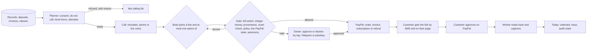

# Callback flow map

Read from the code on the `redesign` branch (10 Nov 2026) and checked against the live site at https://pph-callback.onrender.com. File references are to `src/`.

## Personas

| Persona | Who | How they get in | What they can do |
|---|---|---|---|
| Owner | Maya Chen, owner of Brightside Physio & Pilates (seed) | Owner key, or demo sign-in (`POST /demo/signin-as role=owner`) | Everything: plan, calls, customers, consent, policy, approvals, limits, kill switches, money, safety, evals, demo controls |
| Staff | Jordan Lee, front desk (seed) | Staff key, or demo sign-in as staff | Today, calls (start, speak, hang up, skip), customers (read). No policy, approvals, consent changes or reset (`ownerOnly`) |
| Customer | Any customer, by private token link `/c/<token>` | Link texted with each pay link, or opened by the owner from the customer record | See what is open, pay by PayPal, choose refund or credit for a cancelled class, book a callback, stop calls, see the verify code of the last call, link Telegram |
| Another agent | Any MCP client | Owner key as Bearer on `/mcp`; customer token on `/c/<token>/mcp` | The same tools as the UI, through the same gate |
| Phone network | Twilio | Signed webhooks `/webhooks/voice/*`, `/webhooks/sms` | Turn-based Say + Gather calls; inbound SMS (STOP revokes consent) |

## Screens (server-rendered before the redesign)

Owner and staff: `/today`, `/calls`, `/calls/:id`, `/customers`, `/customers/:id`, `/policy`, `/ops/guard` (approvals, passkey, limits, kill switches, audit chain), `/ops/money`, `/ops/traces`, `/trace/:id`, `/ops/eval`, `/ops/channels`, `/ops/evidence`, `/ops/mcp`, `/safety`, `/safety/model-card`, `/demo`.
Public: `/` (landing), `/login`, `/judge` (five beats), `/llms.txt`, `/skill.md`, `/healthz`.
Customer: `/c/:token`.

## State changes

**Obligation** (`obligations.status`): `open` → `link_sent` (Orders v2 created) → `paid` (capture read back) · `open` → `invoiced` (Invoicing v2 sent) → `paid` (invoice read back) · `open` → `planned` (Subscription created) → `paid` when all cycles complete, or back to `open` if the subscription is cancelled · class: `open` → `refunded` or `credited`. A discount sets `discount_cents`; it is withdrawn if the call ends without a link, invoice or plan (`endCall`).

**Call** (`calls.status`): `planned` or `blocked` (written by the planner after consent, do-not-call, local hours, attempts and cooldown) → `ringing` (Twilio) → `in_progress` (`startCall` re-checks everything and the kill switch) → `ended` with an outcome; or `skipped` by a person. A blocked call can be started; it is re-checked and refused again if still blocked.

**Approval**: `pending` (gate held a move) → `approved` or `declined` by tap, Telegram/WhatsApp button, or passkey countersign above $200. An approved move goes through the gate once (payload hash match, 24 h).

**Customer consent**: granted (owner records words and source), revoked (owner, customer page, "stop calling" on the call, SMS STOP). Revoked or do-not-call is never dialled.

## Money movements

Every one is computed from the records (`balanceOf`, `instalmentOptions`, `discountSteps`), passes `gate()` in `guard/dryrun.ts`, writes a local row with a deterministic `PayPal-Request-Id`, then calls PayPal.

| Move | PayPal call | Amount | Who approves | Where |
|---|---|---|---|---|
| Pay link | `POST /v2/checkout/orders` (intent CAPTURE) | balance after discount | Agent alone up to the autonomy limit ($300 seed); above it the owner | `services/money.ts sendPayLink` |
| Capture | `POST /v2/checkout/orders/:id/capture` | what the customer approved | The customer's own approval on PayPal; the worker captures on read-back | `money.ts captureApproved` |
| Invoice | `POST /v2/invoicing/invoices` + `/send` | balance | As pay link | `money.ts createInvoice` |
| Instalment plan | Catalog product → Billing plan (fixed `total_cycles`) → Subscription | per-cycle amount from `instalmentOptions` | Agent within policy count and minimum; the customer approves on PayPal | `money.ts createPlan` |
| Discount | none (local) | a step from `discountSteps`, capped by policy and limits | Agent within the cap | `money.ts applyDiscount` |
| Class refund | `POST /v2/payments/captures/:id/refund` | what was paid | Agent alone up to $100; customer's own tap always | `money.ts settleCancelledClass` |
| Class credit | none (local) | what was paid | Agent or customer | same |
| Read-back | `GET` order, invoice, subscription | — | worker every tick | `money.ts readBack` |
| Webhooks | `POST /v1/notifications/verify-webhook-signature` | — | — | `web/foundation.ts /webhooks/paypal` |

## AI calls

| Call | Model | Input | Output | What code does with it |
|---|---|---|---|---|
| Call turn | `gpt-5.5` (fallback `gpt-5.4-mini`), Responses API, strict JSON schema | business, purpose, item, balance text (formatted by code), due text, options (ids + labels), last 8 turns, the customer's line after quarantine | `say`, `tool` (enum), `option_id`, `outcome`, `reason` | Unknown option id → rules brain takes the turn. Tool runs through the money service and the gate. The line is scanned for secret requests before it is spoken. Schema has no money fields (`assertSafeSchema`) |
| Policy compile | `gpt-5.5` | the owner's plain words | rules plus quotes | Clamped to the statutory window; consent cannot be disabled; refused and unexpressed parts are shown |
| Live voice | `gpt-realtime` over WebRTC | instructions with options | speech and function calls | Each function call comes back to `/calls/:id/tool` and through the gate |
| Persona eval | rules vs model vs oracle | 60 scripted customers | outcomes | Scored; stored in `eval_runs` |
| Scam text | MiniLM ONNX in the browser | pasted text | score | Advisory only; never reaches the gate |

Without a key the deterministic rules brain (`ai/agent.ts rulesBrain`) takes every turn under the same gate, and the UI says so.

## Message channels

SMS (Twilio), Telegram (one shared bot with deep links), WhatsApp Cloud API, web push (VAPID), and an always-on in-app simulator mirror. Without tokens every message is stored as `simulated` and shown on `/ops/channels`. Owner approvals go to every linked owner channel with Approve and Decline buttons.

## Main journey

